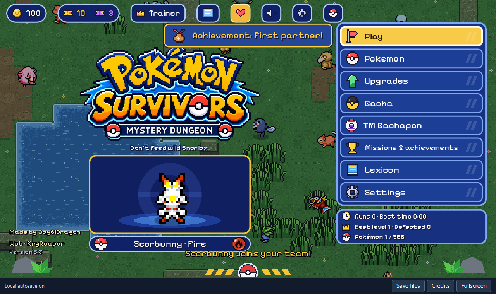

# PokéSurvivor Standalone

Play the Godot edition of PokéSurvivor offline from a single HTML file. Pick a Pokémon, survive waves of enemies, collect experience, and build a set of moves as you level up.

**[Download the latest release](../../releases/latest)**

## Play

1. Download `PokeSurvivor-Standalone.html` from the release assets.
2. Open it in Chrome, Edge, or Firefox with WebGL 2 enabled.
3. Choose a starter, select **Play**, and start a normal run.

Use **WASD** or the **arrow keys** to move, **Esc** or **P** to pause, and the mouse or **Enter** to select an upgrade. Open **Save files** from the menu to move progress between browsers or computers using a JSON backup.

The download is 111.2 MiB. It embeds the engine, artwork, fonts, sound, and game data so it can run from disk. WebGL 2 and a current browser are required. See the recorded gameplay, browser, and save checks in [test results](TEST-RESULTS.md).

## Build and inspect

- [Build guide and source map](docs/BUILD.md) for prerequisites, pinned upstream revision, packaging, and gameplay implementation.
- [Release notes](CHANGELOG.md) for the current build and download checksum.
- [Test evidence](evidence/) for screenshots and machine-readable results.
- [Notices](notices/) for licenses and attribution.

This repository contains the standalone packaging source and Web-specific adaptations. The build uses the pinned upstream Godot project. Download the compiled HTML from Releases.

## Credits

- **KryReaper** — standalone Web edition. [Discord invite](https://discord.gg/SjqVvVEh7f)
- **JPTER78** — original PokéSurvivor.
- **JayElDragon** — Godot port and upstream source. [JayElDragon/poke-survivor](https://github.com/JayElDragon/poke-survivor)
- **SpriteCollab contributors** — Pokémon sprite artwork. [Artist credits](notices/Upstream-CREDITS.md)

The upstream code is MIT-licensed. SpriteCollab artwork is licensed under CC BY-NC 4.0 for noncommercial use. Font and engine notices are included. Pokémon and related names and characters belong to their respective owners. This is a noncommercial fan project.
